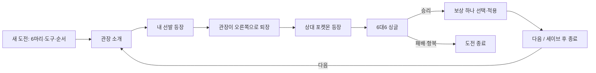

# 싱글 챌린지 검토·계획

검토일: 2026-10-30. 이 문서는 설계와 고정 후보안이며, 챌린지 기능이나 런타임 상수를 아직 구현하지 않았다.

## 확정된 범위

- 도희 제외, 그린은 사천왕 전체 격파 후 배치한다. 24명의 캐릭터가 27전에 등장한다.
- 관동·성도 관장 16명 교차 → 1세대 사천왕 4명 → 2세대 사천왕 4명 → 그린 → 챔피언 목호 → 레드.
- 사용자는 졸업·최종진화 개체 6마리와 도구를 정하고 시작한다. 챌린지는 6대6 싱글이며 기존 대인전의 6마리 등록 후 3마리 선발 절차를 사용하지 않는다.
- 상대 레벨은 모두 100. 원작에서 같은 종이 여러 마리이면 한 마리만 유지하고 부족한 자리를 다른 종으로 보완한다.
- 상대의 종·폼·선발 순서·특성·기술 4개·성격·개체값·도구를 개발 전에 확정하고 버전이 있는 오프라인 상수로 고정한다. 실행 중 파티나 기술을 무작위 추첨하지 않는다. 명중·급소·피해량 등 엔진의 정상 전투 난수는 별개이다.
- 사용자의 현재 레벨·능력치·선택한 기술·특성을 유지한다. 서로 다른 경기에서의 HP·PP 손실을 유지하고 자동 회복하지 않는다.
- 승리 보상은 하나만 선택한다: 한 개체 최대 HP 35% 회복(기절 시 부활 포함), 한 기술 PP 3 회복, 또는 출전하지 않은 졸업·최종진화 개체로 한 자리 교체.
- 퇴출된 개체 ID는 해당 도전에서 재등록할 수 없다. 재시작한 새 도전에는 제한을 이월하지 않는다.
- 새 도전은 선택한 6마리의 전체 HP·기본 최대 PP로 시작한다.
- 패배·항복 시 도전 종료, 다음 시도는 1전부터. 레드 격파는 전체 클리어로 기록한다.

## 고정 6종 후보와 대전 순서

관동은 적·청, 성도·그린·레드는 금·은·크리스탈 파티를 기준으로 한다. 아래 ‘유지’는 중복 종 제거 후 원작 포켓몬이다. ‘보완’은 이번 챌린지용 추천이며 원작 파티라고 주장하지 않는다. 보완은 프로젝트가 지원하는 1~5세대 범위에서 관장의 전문 타입에 맞춘다. 원작부터 전문 타입이 아닌 포켓몬(초련의 도나리, 국화의 아보크 등)은 유지한다. 상대의 원작 미진화 개체는 유지하고, 사용자의 출전 조건만 기존 졸업·최종진화 제한을 따른다.

| 전 | 상대 | 구간 | 유지 | 보완 후보 |
|---|---|---|---|---|
| 1 | 웅 | 관동 관장 | 꼬마돌·롱스톤 | 딱구리·암스타·투구푸스·프테라 |
| 2 | 비상 | 성도 관장 | 구구·피죤 | 야부엉·두트리오·크로뱃·무장조 |
| 3 | 이슬 | 관동 관장 | 별가사리·아쿠스타 | 골덕·라프라스·샤미드·누오 |
| 4 | 호일 | 성도 관장 | 단데기·딱충이·스라크 | 쁘사이저·헤라크로스·핫삼 |
| 5 | 마티스 | 관동 관장 | 찌리리공·피카츄·라이츄 | 에레브·쥬피썬더·전룡 |
| 6 | 꼭두 | 성도 관장 | 삐삐·밀탱크 | 픽시·푸크린·캥카·링곰 |
| 7 | 민화 | 관동 관장 | 우츠보트·덩쿠리·라플레시아 | 나시·아르코·솜솜코 |
| 8 | 유빈 | 성도 관장 | 고오스·고우스트·팬텀 | 무우마·미라몽·샹델라 |
| 9 | 독수 | 관동 관장 | 또가스·질뻐기·또도가스 | 크로뱃·도나리·니드킹 |
| 10 | 사도 | 성도 관장 | 성원숭·강챙이 | 시라소몬·홍수몬·괴력몬·헤라크로스 |
| 11 | 초련 | 관동 관장 | 윤겔라·마임맨·도나리·후딘 | 슬리퍼·에브이 |
| 12 | 규리 | 성도 관장 | 코일·강철톤 | 레어코일·핫삼·무장조·쏘콘 |
| 13 | 강연 | 관동 관장 | 가디·포니타·날쌩마·윈디 | 나인테일·마그마 |
| 14 | 류옹 | 성도 관장 | 쥬쥬·쥬레곤·메꾸리 | 루주라·라프라스·포푸니 |
| 15 | 비주기 | 관동 관장 | 뿔카노·닥트리오·니드퀸·니드킹·코뿌리 | 코리갑 |
| 16 | 이향 | 성도 관장 | 신뇽·킹드라 | 망나뇽·보만다·플라이곤·액스라이즈 |
| 17 | 칸나 | 1세대 사천왕 | 쥬레곤·파르셀·야도란·루주라·라프라스 | 메꾸리 |
| 18 | 시바 | 1세대 사천왕 | 롱스톤·홍수몬·시라소몬·괴력몬 | 강챙이·성원숭 |
| 19 | 국화 | 1세대 사천왕 | 팬텀·골뱃·고우스트·아보크 | 무우마·화강돌 |
| 20 | 목호 | 1세대 사천왕 | 갸라도스·신뇽·프테라·망나뇽 | 킹드라·플라이곤 |
| 21 | 일목 | 2세대 사천왕 | 네이티오·루주라·나시·야도란 | 에브이·후딘 |
| 22 | 독수 | 2세대 사천왕 | 아리아도스·도나리·쏘콘·질뻐기·크로뱃 | 독파리 |
| 23 | 시바 | 2세대 사천왕 | 카포에라·시라소몬·홍수몬·롱스톤·괴력몬 | 헤라크로스 |
| 24 | 카렌 | 2세대 사천왕 | 블래키·라플레시아·팬텀·니로우·헬가 | 마기라스 |
| 25 | 그린 | 최종 구간 | 피죤투·후딘·코뿌리·갸라도스·나시·윈디 | 없음 |
| 26 | 목호 | 최종 구간 | 갸라도스·망나뇽·프테라·리자몽 | 보만다·킹드라 |
| 27 | 레드 | 최종 구간 | 피카츄·에브이·잠만보·이상해꽃·리자몽·거북왕 | 없음 |

총 162자리 = 원작 종 유지 97자리 + 보완 65자리, 서로 다른 종 108종. 파티 후보는 `roster-proposal.json`에 종 ID와 함께 기록했다. 이 목록은 승인·최종 배치 검증 후 고정한다.

## 실제 사용 통계 검토

- Smogon의 5세대 형식 실전 통계 17개를 내려받아 108종을 대조했다. 최근 OU는 2026-07/08/09의 전체 래더(0)와 1630 가중치 자료, 하위 티어·LC·GBU singles 등은 2014-11/2017-08/2022-01 보관 자료다. 2012~2013년에 치러진 경기만을 조사한 것이 아니다.
- 통계는 관측된 특성·기술별 비율이다. 기술 상위 4개가 동시에 채택된 세트라는 증거는 아니다. Smogon BW 분석 세트는 일관된 역할을 정하는 보조 근거이며 실제 사용 통계와 별도로 표기한다. 다른 티어·연도의 비율을 합쳐 ‘전체 사용률’로 만들지 않는다.
- 모든 종의 출처·표본·특성/기술 비율·공략 세트 존재 여부는 `usage-audit.csv`, URL·원문 해시는 `sources.json`에 기록했다. Raw count는 고유 사용자 수가 아니며, 파일 간 최대 표본은 월별 합계가 아니다.
- 아래 ‘30 미만’은 검토 편의를 위한 내부 선별 기준이며 통계적 신뢰도 검정이나 Smogon 공식 기준이 아니다. 30 이상이어도 메타 대표성과 세트 적합성을 별도 검토한다.

### 이번 조사에서 사용 통계 미확인

| 포켓몬 | BW 분석 세트 | 처리 제안 |
|---|---|---|
| 딱충이 (Kakuna) | 이번 데이터에서 미확인 | 실전 통계 기반으로 표기하지 않고 수동 검토 대상으로 분리 |
| 피죤 (Pidgeotto) | 이번 데이터에서 미확인 | 실전 통계 기반으로 표기하지 않고 수동 검토 대상으로 분리 |
| 구구 (Pidgey) | lc | 실전 통계 기반으로 표기하지 않고 수동 검토 대상으로 분리 |
| 뿔카노 (Rhyhorn) | lc | 실전 통계 기반으로 표기하지 않고 수동 검토 대상으로 분리 |

이는 조사한 스냅샷에서 발견하지 못했다는 의미이며, 역사상 사용 사례가 전혀 없다는 뜻은 아니다. 구구·뿔카노는 BW LC 공략 배치를 참고할 수 있으나 레벨 5 포맷을 레벨 100 챌린지의 주류 배치라고 표현하지 않는다. 딱충이·피죤은 합법 습득 범위로 수동 배치를 제안하고 별도 승인 표시가 필요하다.

### 통계는 있으나 작은 표본

| 포켓몬 | 확인 파일 중 최대 Raw count | BW 분석 형식 |
|---|---:|---|
| 아리아도스 | 1 | nu |
| 아르코 | 10 | nu |
| 삐삐 | 14 | zu |
| 쥬레곤 | 22 | nu |
| 두트리오 | 18 | pu·vgc2012·nu |
| 가디 | 12 | lc |
| 또가스 | 8 | lc |
| 단데기 | 10 | 미확인 |
| 야부엉 | 3 | nu |
| 쥬쥬 | 3 | lc |
| 포푸니 | 11 | nu |
| 찌리리공 | 9 | lc |

단데기는 이번 데이터에서 공략 세트도 확인하지 못했다. 통계가 존재한다는 이유만으로 10회 관측 배치를 ‘주류’라고 확정하지 않는다. 나머지 종도 실제 사용 증거·합법성·단일 역할 검토를 통과한 뒤 고정한다.

### 통계 근거가 분명한 예

2026-09 gen5ou-1630 단일 자료의 특성 비율: 핫삼 테크니션 99.966%, 망나뇽 멀티스케일 99.719%, 아쿠스타 애널라이즈 74.262%. 핫삼은 불릿펀치·엄청난힘·따라가때리기·유턴, 망나뇽은 용의춤·역린·신속·불꽃펀치처럼 함께 성립하는 역할을 검토할 수 있다. 최종 상수는 각각의 습득 조합과 도구까지 통과해야 한다.

### 배치 확정 규칙

1. 통계의 특성·기술 후보를 BW 분석 세트의 역할과 대조한다. 독립 사용률 상위 4개를 단순 복사하지 않는다.
2. 5세대에서 실제 획득 가능한 종·폼·특성·기술 조합을 검증한다. 미해금 숨겨진 특성, 배포 한정 기술과 숨겨진 특성의 양립 불가, 교배/이전 제약을 걸러낸다. 예: 피카츄의 신속·숨겨진 특성 조합은 배포 출처까지 확인한다.
3. 상대는 5세대 기술만 사용한다. 프로젝트의 6세대 페어리 기술·메가진화 예외가 있다고 상대에게 자동 부여하지 않는다. 사용자의 기존 선택 가능 범위는 별도 제한 지시 전까지 유지하는 안을 권장한다.
4. 잠재파워는 원하는 타입에 맞는 개체값까지 고정한다. 기술 이름만 바꾸거나 모든 개체값 31로 두고 다른 타입이라고 표시하지 않는다.
5. 상대 능력치는 사용자와 동일한 계산 체계를 쓰는 안을 권장한다: 레벨 100, 기본 IV 31, EV 0, 성격 고정(잠재파워용 IV 예외). 실전 EV 배분까지 복제하면 현재 EV 없는 사용자 육성과 조건이 달라지므로 별도 결정한다.
6. 시바 1·2세대, 독수 관장·사천왕, 목호 사천왕·챔피언은 서로 다른 encounter ID와 6종/세트 상수를 갖는다. 같은 종도 역할·기술을 달리한다. 특성이 하나뿐이거나 한 특성만 실전 근거가 뚜렷하면 무조건 다르게 강제하는 것은 통계 기반 요구와 충돌하므로 예외 승인이 필요하다.
7. 도구도 고정하고 팀 내 중복을 제한한다. 실전 자료의 전기구슬·진화의휘석·구애머리띠·구애안경·검은진흙 등은 현재 프로젝트 도구 허용 목록에 없다. 실제 세트의 핵심 도구를 바꾸려면 변형 배치로 표시하거나 필요한 도구를 먼저 명시적으로 확장한다.
8. 최종 `ChallengeEncounterCatalog`는 출처와 함께 버전·해시를 고정한다. 실행 중 웹 조회나 최신 통계 갱신을 하지 않는다. 새 버전으로 수정해도 기존 도전에는 시작 당시 catalog 버전/스냅샷을 적용한다.

## 화면과 진행 흐름

배틀 탭에 ‘대인 배틀 / 챌린지’를 구분하는 진입점을 두고 기존 매칭은 유지하는 안이다.

- 처음 클릭한 순서를 출전 순서로 사용하고 첫 개체에 LEAD를 표시한다. 기존 3마리 재선발 화면은 생략한다.
- 다음을 누르면 다음 관장이 상대 포켓몬 영역에 나타난다. 내 생존 선발이 등장한 뒤 관장이 오른쪽으로 완전히 퇴장하면 상대 포켓몬이 등장한다. 실제 첫 턴 전까지 기술 입력을 잠근다.
- 기존 GIF·플로팅, PokéRogue 기술/등장/회수/울음소리, BGM·효과음 볼륨 설정, 기술 정보·PP·명중률·상성·상태 알림을 재사용한다. 관장 표시용 PNG/JSON 아틀라스 뷰를 추가한다.
- 캐릭터 원본이 여러 프레임이면 해당 애니메이션을 사용하고, 1프레임 리소스는 정적 디자인으로 표시한다. 원본에 없는 움직임이 제공된다고 가정하지 않는다.
- 마지막 타격·HP 감소·기절·승패 연출이 끝난 뒤 보상을 연다. 엔진의 승리 판정이 먼저 도착해도 재생 중에 다음 상대를 시작하지 않는다.
- 보상은 한 번만 적용한 뒤 ‘세이브 후 종료’, ‘다음’을 활성화한다. 27전 레드 승리 후에는 클리어 결과와 종료를 표시한다.

## 자원과 보상

- HP 회복: `min(maxHP, currentHP + max(1, floor(maxHP * 0.35)))`. 기절 상태에도 적용하고 양수가 되면 부활한다.
- PP 회복: 개체와 기술 하나를 고르고 `min(maxPP, currentPP + 3)`을 적용한다. 프레셔·원한 등의 실제 엔진 차감량을 최종 moveSlots에서 가져온다. 현재 앱에는 PP 증가 아이템이 없으므로 기본 최대 PP 체계를 유지한다.
- 교체: 출전하지 않았고 퇴출 이력에도 없는 소유 개체 중 기존 출전 조건을 만족하는 한 마리를 골라 기존 자리 하나와 교환한다. 새 개체는 전체 HP·기본 최대 PP로 투입하는 안을 권장한다. 퇴출 개체의 자원은 재활용하지 않는다.
- 추천: 독·화상·마비·잠듦·얼음 같은 주요 상태이상은 유지하고, 스탯 등급·혼란·씨뿌리기·대타출동·필드/날씨·진영 함정 등 한 경기 내부 상태는 초기화한다. 맹독 단계는 새 경기 기준으로 초기화한다. 잠듦 카운터 등 상태에 필요한 내부 수치는 별도 보존한다.
- 추천: 소모·빼앗김·트릭 등으로 바뀐 도구 상태를 보존하고, 새 경기에서 메가진화 기회는 다시 부여한다. 메가 폼은 일반 폼으로 돌아오되 HP/PP는 회복하지 않는다.
- 교체로 들어오는 개체의 도구는 아직 결정이 필요하다. 자원 무한 보충을 막으려면 기존 자리의 남은 도구를 호환 시 승계하고, 호환되지 않는 메가스톤은 없음으로 처리하는 안을 권장한다. 컬렉션 기본 도구를 매번 새로 지급하는 안은 소모형 도구를 반복 보충할 수 있다.
- 추천: 동시 전멸로 무승부가 발생하면 도전 실패로 처리한다.
- 보상 화면에서 실제로 선택한 경우에만 적용한다. HP·PP가 모두 가득 차거나 교체 후보가 없는 경우의 보상 건너뛰기, 남은 보상 처리, 마지막 레드 후 보상 생략을 명시적으로 처리한다.

## 엔진·저장 구조

현재 `BattleMode.singles.battleSize`와 엔진 `OwnedBattle`은 등록 6마리를 3마리로 잘라 전투에 넣는다. `BattlePokemon` 입력에는 현재 HP·PP가 없고, 시작 시 모든 기술 PP를 최대값으로 초기화한다. 현재 대인전 coordinator는 LAN 연결·양쪽 준비 상태·통신 타이머와 결합되어 있다. 그래서 상대 이름만 바꾸는 작업으로 구현할 수 없다.

- `ChallengeRunStore`: 도전별 원자적 로컬 저장 파일. run ID, 데이터 버전, 다음/현재 encounter ID, 6개체 스냅샷, 현재 HP·PP·상태·도구, 순서, 퇴출 ID 집합, 보상 적용 ID, 클리어/패배 이력을 관리한다. 컬렉션 원본·도구 사용 기록과 도전 중 자원을 분리한다.
- `ChallengeCoordinator`: 로컬 CPU 전투·소개·승리 보상·종료·재개를 관리한다. 네트워크 매칭과 응답 시간 제한을 끌어와 가짜 상대를 붙이지 않는다.
- `ChallengeOpponentCatalog`: 확정된 27팀·출처·버전. 전투 중 팀 구성 난수 없음. 설정 검증기는 6종·레벨·도구 중복·획득 가능 기술 조합·특성·번역·이펙트/울음소리 존재를 검사한다.
- 배틀 시작 옵션에 battleSize 6과 진행 중 자원 상태를 명시적으로 넘긴다. 기존 대인전의 싱글 3/더블 4를 바꾸지 않는다. 기절 개체도 팀 이력에 남기되 선발·교체 후보에서 제외하고 6마리 중 살아 있는 개체가 없으면 패배한다.
- 자원 복원은 등장 특성·첫 턴 처리 전에 수행한다. 진짜 엔진 상태에서 HP, moveSlots의 PP, 주요 상태이상, 현재 도구를 내보낸다. HP 비율 표시값이나 재생 중 임시 프레임에서 저장하지 않는다.
- 소모형 도구 소진·트릭 등 경기 중 합법적 도구 변화는 초기 등록의 중복 검사와 구분한다. 이전 경기에서 변한 상태 때문에 다음 경기 시작 검증이 실패하지 않아야 한다.
- 추천 재개 정책: 승리/보상뿐 아니라 확정된 턴마다 battle seed·초기 자원·결정 로그를 체크포인트로 저장한다. 앱 종료 후에는 조용한 재생으로 동일 상태를 복원하고 과거 이펙트를 다시 보여주지 않는다. 저장을 불러와 같은 보상을 재수령하거나 난수를 바꿔 재도전하지 못하게 한다. 이 정책과 경기 중 X/강제 종료 처리는 구현 전에 확정한다.
- 보상 transaction ID와 상태 전이를 한 번에 저장해 종료/다음의 연속 클릭·프로세스 중단에도 보상을 중복 적용하지 않는다. 데이터 손상·지원하지 않는 버전은 원본을 보존하고 복구 안내를 제공한다.

## CPU 의사결정

- 고정 선발 순서와 세트를 사용하되 매 턴 기술·교체 선택은 실제 상태에 따라 결정한다. 단순히 첫 기술 반복이나 무작위 기술 선택을 사용하지 않는다.
- 우선도·스피드·트릭룸·타입·면역·남은 HP·자신의 기술·설치기·회복기·상태이상·교체 위험을 평가한다. 현재 합법 행동만 제출하고 턴 순서는 기존 엔진이 결정한다.
- 상대가 아직 보여주지 않은 기술·도구나 사용자가 지금 누른 미공개 행동을 읽지 않는다. 동일 평가점수는 고정된 기준으로 결정해 CPU 행동도 재현 가능하게 한다.
- AI 내부 계산은 기술 정보 화면에 예상 피해량을 새로 노출하는 기능과 별개이다.

## 단계별 구현·검증 계획

1. 데이터 확정: 27팀 후보, 통계 미확인/표본 부족 종의 수동 배치, NPC 도구 허용 범위, 세대별 독립 세트를 확정한다. 출처·상수·합법성 검증부터 만든다.
2. 엔진 연동: 실제 6대6 싱글과 HP·PP·기절·도구·상태의 입력/출력 보존을 먼저 테스트한다. 기존 대인전 싱글 3/더블 4 회귀를 확인한다.
3. 도전 저장·보상: 2~3연전 fixture로 HP·PP 누적, 35% 부활·회복 상한, 기술 하나 PP+3, 영구 퇴출, 패배 초기화, 저장 후 재개·중복 보상 방지를 검증한다.
4. CPU와 관장 연출: 실제 엔진으로 판단·강제 교체·우선도·경기 종료를 확인하고, 관장 퇴장/포켓몬 등장/공격/HP 재생의 순서를 검증한다. 모니터 테스트창은 별도 지시 시 실행한다.
5. 전 구간 QA: 27팀 합법성, 관장 순서, 중복 캐릭터 별도 세트, 레드 클리어, 모든 보상과 포기/재개·경계 상황을 통과시킨다. 자동연전으로 soft-lock·무한 교체·PP 고갈/발버둥·동시 기절·전멸을 확인한다.

## 남은 결정과 제한

- 이 문서의 추가 65자리 후보를 고정할지, 통계 미확인·표본 부족 종은 BW 공략/합법 습득 기반 수동 배치로 승인할지.
- 사용자와 같은 EV 없는 상대 능력치를 쓸지, 실전 EV를 추가할지. 상대의 통계 기반 핵심 도구를 어디까지 허용할지.
- 상태이상/도구 소모의 경기 간 유지, 교체 개체의 도구, 경기 중 종료/재개 정책.
- 사천왕·그린·목호 승리에도 같은 보상을 줄지. 27연전 자원 설계에는 모든 비최종 승리(26회)에 하나씩 주는 안을 권장한다.
- 같은 종의 특성이 세대마다 반드시 달라야 하는지. 단일 특성 또는 특정 특성만 통계 근거가 있는 경우는 기술·역할 차별화가 더 적절하다.

요청한 범위는 조사·설계까지다. 플레이 코드 수정, 릴리즈노트 추가, ZIP 생성, 커밋/푸시는 이 작업에서 수행하지 않았다.
