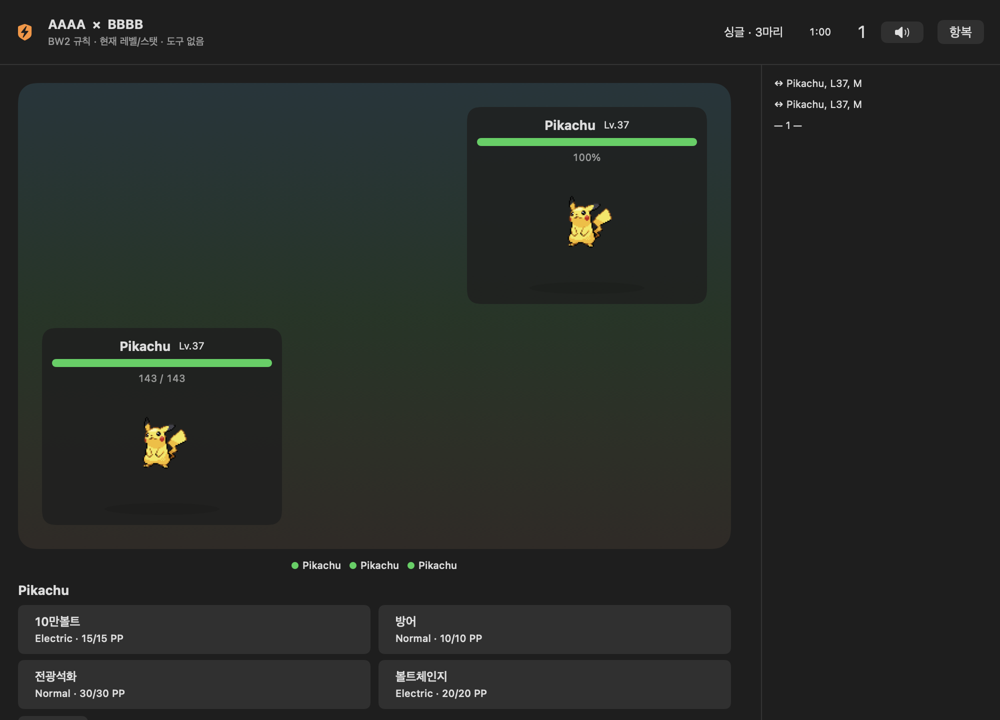
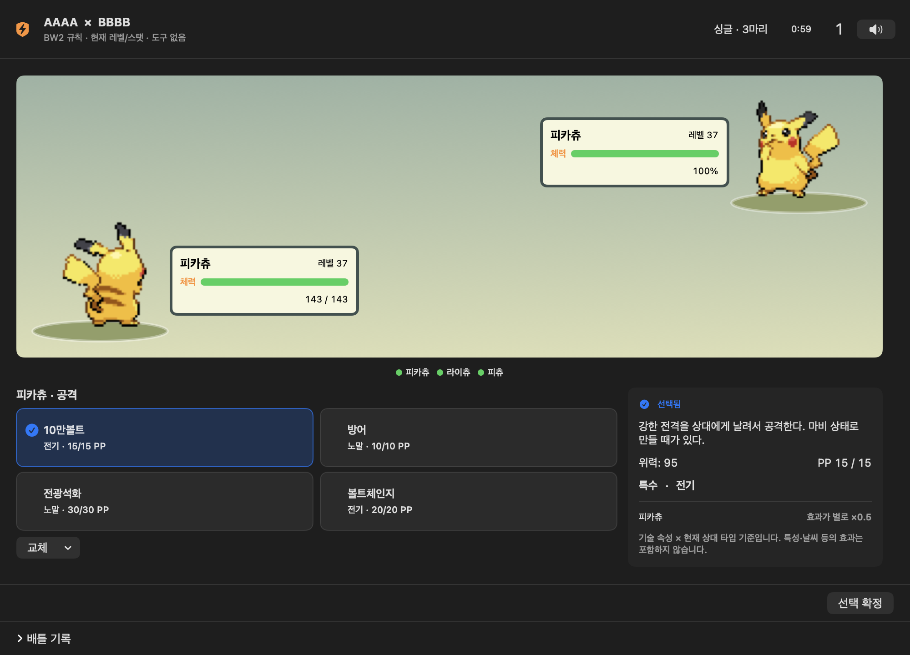
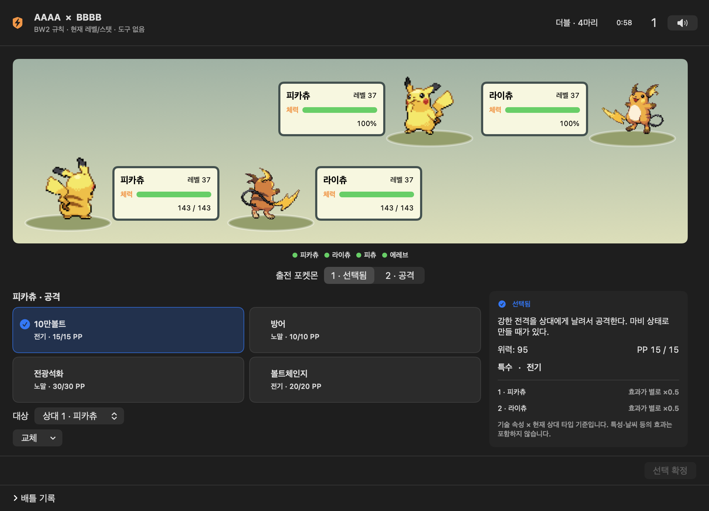
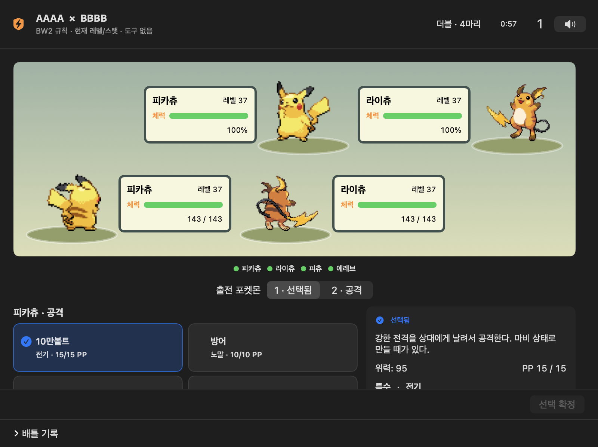
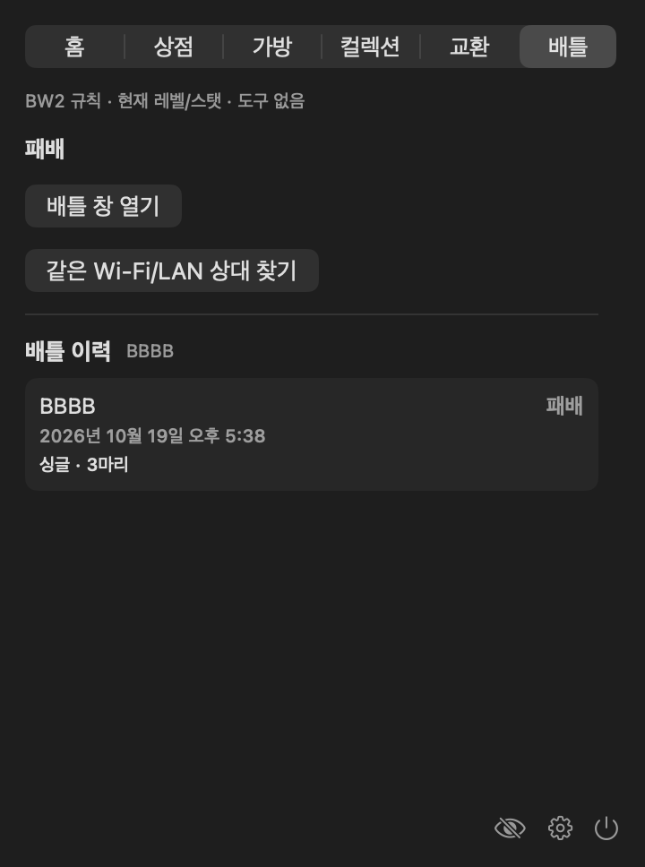

# Local battles

Battle appears immediately after Trade. Two Macs use the trade connection infrastructure with a separate `ptb-battle` service (Wi-Fi/LAN, not a promise of identical SSIDs). Match requests advertise and browse continuously without a search deadline. The list contains peers requesting a match; selecting one pauses both advertising and browsing while retaining the browser until its invitation completes. Incoming connections also pause discovery. Cancel clears the list and releases discovery; a new request starts a fresh generation so queued old callbacks cannot revive it. Manual TCP codes are available through an explicit Manual connection button, never an automatic ten-second fallback. Reconnecting active battles advertise as unavailable for new matches; their existing opponent can still rediscover them. Both players agree to the same mode and mark their teams ready; transport acceptance is not battle consent. Both modes register six owned stored individuals. Each registration exchanges a public preview containing only identity, species/form, level and shiny appearance. Once both players have registered, a single preparation view shows both six-member teams together. The player then selects and orders three for singles or four for doubles from their own roster. Only those selected members enter the engine and can switch in, including forced replacements; the unused registered Pokémon cannot prevent a loss. The first selected battle card shows LEAD at its upper left. Singles starts with #1 and doubles with #1/#2. Opponent slots show question marks only until registration arrives; then all six species/sprites are public. Final lineup selections and their order stay unmarked on the opponent’s preview. Moves, abilities, nature, IVs and numerical stats are excluded from the preview packet. Both players must submit final readiness before battle begins. Once registered, each six-member roster is immutable for that matching session. There is no edit/withdrawal button, repeat registration cannot replace the snapshot, and peer replacement/withdrawal packets are rejected. Mode changes are also disabled after either roster is registered. Canceling final readiness preserves both registered rosters; canceling matching or starting a new match clears them. Engine-start errors preserve the registration too. The simulator’s separate Team Preview is disabled because the app handles preparation, and it emits no roster log. During battle, engine frames expose only the opposing active Pokémon. Released and currently raised individuals are excluded.

## Mechanics and individual stats

`BattleEngine/engine.cjs` wraps pinned Pokémon Showdown 0.11.11 with generation-V BW2 mechanics. `BattleTeamBuilder` freezes the current level, all six computed values, IVs, nature and existing moves. There are no EVs, level normalization, PP Ups, rewards or permanent HP/status changes. Duplicate individuals and duplicate species within one team are rejected. Different forms share the same National Pokédex species number; each opposing team may independently use the same species. The picker disables other individuals of a selected species, and readiness and the canonical engine roster validate the rule again. A preflight helper validates the roster before readiness.

Collection individuals can save a preferred battle item in the same profile save file.
When assembling the six-member roster, use the collection preference first, then the last
explicit battle Apply choice for that individual, then None. Clearing a collection preference
re-enables the recent-item fallback. Incompatible imported preferences also fall back.
A manual item choice (including None) overrides these defaults for the current registration.
Resolve duplicate items in registration order: the first holder equips it and later holders
use None, without erasing either preference. The locked registered roster remains unchanged
when collection preferences change. Released and currently raised individuals cannot set a
collection battle item. Item selection retains categories, descriptions, localization and
recency ordering.

The collection's individual stat rows show an IV grade as `★(1)` through `★(15)`.
The 32 IV values use fifteen bands (`floor(IV * 15 / 32) + 1`), with 0 at grade 1 and
31 at grade 15. These labels do not change IVs or computed battle stats.

Pokémon whose type depends on a held item cannot participate. In generation V this excludes Arceus in every form, including Normal. The picker disables these individuals with an explanation; both native preflight and the host engine reject them as well. Weather-driven form changes remain legal and sprites follow the current battle form.

The app currently displays default-form, present-day PokéAPI base stats alongside BW2 learnsets. The battle format is explicitly `ptb-bw2-owned-stats-v1`: imported starting stats override only the individual's original species calculation. Switching preserves those values; genuine battle form changes, Transform, boosts, status, weather, abilities, damage rolls and targeting use the simulator. This is an app-specific format rather than unchanged cartridge stats. Non-default form abilities map the saved ability slot to the actual generation-V form; incompatible abilities on ordinary forms fail preflight. Stored profiles are not rewritten to make them legal.

The runtime contains the rules database. Runtime API requests are used for existing metadata and localized names, not for turn resolution. No public Showdown server is used. Battle presentation uses the bundled eight-language catalog, so names and move descriptions never fall back to English when another app language is selected. Combat continues offline once Pokémon details are cached.

## Battle screen and move inspector

Both front and back sprites are cropped to their actual alpha bounds, fit without distortion, and bottom-aligned so the last visible pixel sits five logical pixels above the 22-pixel ellipse's center. Native tests measure rendered pixels with tall/wide sprites and different transparent margins.

The battle stage places the player's back sprite at the lower left and the opponent's front sprite at the upper right, with HP panels beside each Pokémon. Doubles preserves that diagonal arrangement for two active individuals per side. Commands offer Fight and Switch; surrender is available through the window's X confirmation. The battle log is collapsible below the stage and commands.

Selecting a move marks it Selected and opens the right-hand inspector without submitting a turn. The inspector shows the description, generation-V base power, remaining/max PP, Physical/Special/Status category, type and type-chart matchup for each active opponent. It does **not** calculate expected damage. Multipliers 0, ¼, ½, 1, 2 and 4 compare the move's intrinsic type against current opponent types only; abilities, weather-dependent move changes, accuracy and other damage mechanics are excluded from this preview. Status moves show their category instead of a damage multiplier. Opposing exact HP/stats remain private.

Descriptions and names come from the bundled `BattleText` catalog in the selected language. PokéAPI translations prefer BW2 then the nearest available source in that language; missing Portuguese/Russian strings are prepared with local translation models. The app never invokes a translation service or silently substitutes English. Numeric power/category/type remain sourced from the pinned BW2 simulator, so modern PokéAPI values do not silently replace generation-V values. The bridge revision includes `move-details-v1`; both peers need the updated app. Back sprites have separate cache keys, retaining existing front-sprite cache compatibility.

## Ownership, protocol and outcomes

The app owns `BattleCoordinator` and `BattleWindowController`. Closing the popover/changing tabs does not tear down battle. One match per app instance; trade controls are unavailable while the battle is active.

A version/revision and per-connection battle ID gate messages. Monotonic sequences reject old/duplicate messages. The host resolves turns and sends only the recipient's frame: opposing exact HP and stats are not transmitted. Own HP is exact, opposing HP is a percentage. Both sides commit choices; the guest reveals after the host has chosen, or when only the guest has a forced-replacement request. This is friendly local play; the host necessarily holds full engine state and locally edited saves are not cryptographically authenticated.

The engine requests team order, regular turns or forced replacements. Doubles supports per-slot actions/targets, spread moves, switching and insufficient-bench replacements. Both active slots cannot choose the same bench individual. A 60-second decision deadline is displayed; one missing choice loses on time, both missing ends as interrupted. A temporary disconnect pauses that clock for a 30-second recovery interval; Multipeer reconnect resends the latest state rather than rerunning a turn. Manual connections can reconnect using a code. Host process failure or expired recovery produces an interrupted result, not a fabricated winner.

During a match, X opens **“정말 종료하겠습니까?”** (localized elsewhere) with Confirm / Cancel. Cancel leaves the battle active. Confirm sends surrender, records local defeat/opponent victory, stops BGM and hides the window. The reliable connection stays alive briefly for delivery/acknowledgement. App Quit uses the same confirmation. Sudden network/process loss cannot guarantee delivery of an explicit surrender and follows the interruption policy.

## History

`Application Support/PokeTokenBar/battle-history-v1.json` (or `PTB_STATE_DIR`) stores match IDs, opponent code/name, mode, timestamps, outcome, termination reason, own frozen team and turn count. This is independent of Pokémon save import/export. A result is recorded once per battle ID with only the three/four selected participants, preserving their submitted order. Failed writes retain the result in memory and retry; a corrupt existing file is preserved with a visible error.

The battle tab shows the selected opponent with a checkmark / Selected label. Its lower section shows that opponent's history, or all history when no opponent is selected. Opponents are matched by device code, so renaming a nickname does not split their history.

## Audio and effects

The Gold / Silver **Johto Wild Pokémon Battle (Day)** archive recording defaults to 35% volume and can be muted. The header's slider button opens a localized 0–100% volume control; changes update the current mixer immediately and persist across battles and app restarts (`battleMusicVolume`). A saved zero remains silent on the next battle. The original recorded intro plays once, then its tagged battle section repeats on one audio node without replaying the intro or a fade. PCM assets, source URL, exact loop frames and hashes are documented in `BattleEngine/music/README.md` and `wild-battle-source.json`. Playback stops on terminal outcomes and disconnect; it restarts with the match.

Sprites stand five points above the shadow center. Their lower-quarter visible stance is horizontally centered over the ellipse, rather than centering a bounding box distorted by asymmetric tails. One opacity/duration-weighted anchor across all animation frames preserves floating and pose motion in both singles and doubles.

Move effects use an offline catalog converted from pinned Showdown effect-only timelines and selected textures. All 560 current catalog entries resolve to 559 canonical IDs: 476 use imported effect operations; 83 whose upstream animation contains only Pokémon motion/backdrops use original native type/category effects. The resource also includes 906 matching recipes across generations. Existing Pokémon GIFs, idle movement and stance geometry remain unchanged; upstream sprite movement, scaling, fading and afterimages are excluded.

Explicitly tagged animation variants resolve in order **5 → 9 → 8 → 7 → 6 → 4 → 3 → 2 → 1**, then a generation-independent recipe. The provided Showdown and Showmotion tables are not generation-specific asset packs. Current imported recipes are honestly tagged as shared, not as original BW2/Gen IX animations. Effect generation does not change the generation-V battle rules or legal moves. Runtime matching uses canonical engine `moveID` values, including the Vice Grip alias, independently of UI language.

Native timelines use actual stage anchors for each singles/doubles target, per-move duration, bounded drawing, miss/immunity/Protect/failed-status suppression and a short static Reduced Motion outline. Eighteen additional preparation timelines distinguish charging from the actual strike; unavailable preparation effects use a caster aura. Source, attribution, excluded texture licenses, hashes and regeneration instructions are bundled in `Resources/BattleEffects/NOTICE.md` and `source-sha256.json`.

Showmotion's **nine original GPU effects** are now a separate optional rendering path, not native approximations: Swords Dance, Moonblast, Mystical Fire, Shadow Ball, Will-O-Wisp, Psychic, Hydro Pump, Gunk Shot and Flower Trick. Six are legal generation-V moves and appear in normal BW2 battles. Original `.efkwgd` files, WASM runtime, Three.js camera/renderer and bloom shaders are pinned and hash-verified. A transparent WKWebView overlays only the battlefield; Pokémon GIF playback and geometry remain native and unchanged. Explicitly tagged generation variants still take priority over shared effects.

A token-protected read-only loopback server supplies bundled files to WebGPU's trustworthy origin. A first-visibility loading race retries the cached effect once after upstream resume suppression. GPU drawing pauses when idle; closing the view stops the page and server. Missing WebGPU, failed initialization, charge phases, blocked targets and Reduced Motion retain native fallback. Timeouts disable further original attempts in that window to avoid repeatedly consuming turn time. The `Showmotion` badge is emitted only after positive particle **and** draw counters. Runtime readiness alone is not proof of original playback.

Run `PTB_SHOWMOTION_PREVIEW=1 scripts/preview-battle.sh` for the six legal original effects without user save data. The initial Pokémon has Hydro Pump, Swords Dance, Shadow Ball and Psychic; teammates provide Gunk Shot and Will-O-Wisp. `scripts/ShowmotionValidation.swift` validates the original GPU assets in a visible application window independently of the battle's legal move set.

## Build and verification

Development needs Node/npm in addition to Swift. Run:

```sh
./scripts/prepare-battle-engine.sh
swift test --filter BattleTests
./scripts/test-gate.sh
PTB_NATIVE_ARCH_ONLY=1 PTB_SKIP_INSTALL=1 ./scripts/build-app.sh
```

The preparation script uses the npm lockfile and the pinned Node 22.18.0 runtime. Development builds for this feature target Apple Silicon only (`PTB_NATIVE_ARCH_ONLY=1`), and the bundle strips the helper runtime to the same CPU slice. The app build copies only simulator/data/config/library modules, their required dependency and notices, strips source maps, and signs the nested Node executable before the app. This increases the bundle size. End users do not install Node or npm. `PTB_SKIP_INSTALL=1` builds without replacing the installed app.

The full gate runs both engine and Swift tests. Core fixtures verify exact imported stats in both modes (including a deliberate stat-import mutation), completed singles/doubles matches, immunities, PP, switching, forced replacements and surrender. Swift integration tests use two in-memory clients with the real subprocess engine; they cover consent, turn resolution, reconnect without repeated damage, stale frames, X Cancel/Confirm, data persistence and history write recovery. `PTB_BATTLE_SCREENSHOT_DIR` enables native sample-team renders of the separate battle window and the battle/history tab.

Before distribution, run a match on two physical Macs over the intended Wi-Fi, including local-network permission denial and router client isolation. In-memory protocol tests do not certify radio discovery, router behavior or both physical CPU architectures. A universal binary verifies slices, not a full Intel hardware run.

## Native UI samples

These are native renders of the production views with sample teams and local fixture opponents, not a two-Mac Wi-Fi session. Battle is a new screen with no previous battle screen. The compact view scrolls its battle pane while retaining the header and log.







Battle stages play the same generation-V GIF idle animations as the floating pet, with back-facing GIFs for the local team and front-facing GIFs for opponents. A shared alpha crop across all poses preserves native movement and keeps the lowest pose five logical pixels above the ellipse center. Frame delays are retained; switching/form changes cancel the previous playback task. Missing GIFs use the static fallback while the shared cancellable recovery loader retries. Fainted Pokémon and the system Reduce Motion setting stop playback.

## Interactive development sandbox

Run `./scripts/preview-battle.sh` on Apple Silicon to open the production battle UI in a standalone AppKit app. It uses a real NSApplication input loop, an automatic in-memory opponent, isolated temporary profiles/history, BGM, and a 30-minute decision limit. Production matches keep the 60-second limit. Choose a move, then click the fixed **Confirm choices** footer button; closing the window terminates the sandbox. The older opt-in XCTest preview also pumps native events, but the standalone app is preferred for human input/audio testing.

The current audio is the archived Gold/Silver/Crystal Johto Wild Pokémon (Day) recording with its original intro and tagged loop section. It replaces the earlier synthesized Trainer Battle loop.

## Move selection and visual presentation

Move buttons keep a 64-point height and a reserved icon slot in both states. Selection changes the background/border and shows a check to the left of the localized name; it does not insert a label row.

The `effects-v1` bridge carries every resolved move in log order, with public BW2 type/category, stable event IDs and recipient-relative source/target slots. Both peers need the updated revision. Sprite anchors route native lightning/projectiles to singles/doubles targets; physical moves add slashes and status moves use auras/shields. Immune, missed and protected targets do not receive hit bursts. The generic Hidden Power animation type preserves the opponent's private IV-derived type. New events play once; reopening/reconnecting seeds the cursor at the current event and does not replay history. The 60-fps effect timeline is removed while idle, each move lasts 0.85 seconds, and Reduce Motion uses a brief static outline. Commands are temporarily disabled during playback. These are procedural app effects rather than a bundle of the original game's individual move animations.

### Pikachu effect quality sample (2026-10-20)

The four normal Pikachu preview moves (`thunderbolt`, `protect`, `quickattack`, `voltswitch`)
now have authored effect-only profiles in `PikachuMoveEffects`. These are new native Canvas
compositions, not original Showmotion assets or claimed generation-specific game effects.
They combine additive glow, layered deterministic particles, branching lightning, a hexagonal
barrier, speed streaks and projectile/return trails. The production layer uses their own
bounded durations; Reduced Motion keeps the prior static cue. Hit effects require the
engine hit flag, and charging retains the existing path. Other move profiles are unchanged.

Run `PTB_PIKACHU_COMPARE=1 ./scripts/preview-battle.sh` for a development-only side-by-side
comparison. Both sides use the production `BattlePokemonStage` with animated front/back GIFs.
For inspection, old and new effects use the same normalized timeline (the old animation's
actual production duration is unchanged). Select a move, repeat/replay, reverse the attacker,
toggle hit, or pause/scrub only the effect while the Pokémon GIF keeps playing. This sandbox
has no battle engine, save writes, HP/PP consumption or audio. UI is Korean, matching this
preview's selected language; canonical IDs and production move labels remain localized.
The sample is limited to these four move IDs pending visual approval of the style.

### PokéRogue background/motion sandbox

Run `PTB_POKEROGUE_PREVIEW=1 ./scripts/preview-battle.sh`. This builds a separate
`PokeTokenBarPokeRoguePreview.app` (distinct bundle identity from the prior quality comparison).
The three groups are ordered: 15 background-centred moves, 30 movement-centred moves, then
Nature Power / Rest / Secret Power (all three original JSONs have zero frames). Next and
optional automatic advancement traverse this order; the final group explicitly shows the
missing original instead of inventing an imported effect. The left field retains the current
app's presentation and the right field applies the original JSON/background PNGs to Pikachu.

The original GIF stage remains animated. A preview-only checkbox enables source translation,
rotation, scale, opacity and afterimages on the outer sprite views; disabling it shows the
background with the unchanged stage alone. Effects can be paused/scrubbed without pausing the
GIF. Direction variants and self-targets are mapped to the actual participant anchors. Tone is
approximated by native color multiplication, and backgrounds tile to this preview's viewport;
this is an inspection adapter, not a pixel-identical Phaser port. No effects audio, real combat,
PP consumption or personal-save writes occur. Move legality is intentionally bypassed only in
this visual sandbox so Pikachu can demonstrate the entire requested subset.

Original fixture files and their hashes/notices are under
`Tests/PokeTokenBarTests/Fixtures/PokeRoguePreview`; they are copied only into the development
preview app, not the normal application resources. Rebuild them from a pinned external checkout
with `python3 scripts/prepare-pokerogue-preview.py /path/to/pokerogue-assets`. The independent
adapter in `PokeRoguePreview.swift` is not connected to normal battle playback.

The PokéRogue sandbox's **가시성 보완** switch adds independently authored effect geometry
for Psychic, Confusion, Telekinesis, Power Split, Power Trick, Meditate, Work Up and Nightmare.
Their bundled Korean BW2 descriptions define target/caster scope and the visual concept; no
status proc, HP or stat change is simulated. Psychic uses a stronger target pressure field than
Confusion, Telekinesis uses rising rings, Power Split connects both sides, and Power Trick
uses opposing energy orbits on the caster. Psychic/Confusion's original background opacity
receives a bounded readability floor in this mode. The original files remain byte-identical,
and switching readability off shows the raw importer again. Empty-original profiles are not
silently filled. The header shows the selected move's localized description. Reduce Motion
holds the comparison at a fixed phase while GIF playback remains independent.

Launch focused on Psychic with:
`PTB_POKEROGUE_PREVIEW=1 PTB_POKEROGUE_MOVE=psychic ./scripts/preview-battle.sh`.
These additions remain in the visual sandbox and are not a new normal-battle effect provider.
The PokéRogue preview window fits its complete side-by-side canvas and controls to the active
screen's visible size at launch, avoiding an off-screen target on smaller desktops.

### Production PokéRogue provider (2026-10-20)

Collection move and ability pickers expose localized help on the current selection and each
native menu candidate. Move help includes description, type, physical/special/status category,
Gen V power and base PP; ability help includes its description. Checked selections and duplicate
move restrictions remain in the native menu, and changing a selection uses the same save methods.
Released records remain read-only with help available. Same-type attack bonus is applied by
the unchanged BW2 engine (normally 1.5×; Adaptability 2×); it does not change stored stats or the
opponent-type-only effectiveness label. Singles/doubles damage tests cover both multipliers.

Move tooltips and selected battle move details also display localized base accuracy. Numeric
values retain their percentage; simulator `true` is displayed as “Always hits”, not 100%.
This is the BW2 move's base value, not a predicted hit probability after weather, abilities or
accuracy/evasion stages. Those modifiers continue to apply in the engine at execution time.
The inspector's existing power/PP row includes accuracy without adding a new layout row.

The left weather/field panel shows finite effect timers as `remaining/maximum` (for example,
`4/5` for rain or Trick Room and `3/4` for Tailwind). The engine observes successful field/side
initialization and restart callbacks to retain the real initial duration while the remaining
value counts down. Expired effects disappear; replaced effects get fresh timers. Gen V ability
weather and permanent hazards show localized “Until removed”, including suppressed weather.
The move's activation turn consumes a turn under BW2 rules, so the next decision commonly
shows `4/5`. Timers are public battlefield metadata; stored Pokémon stats are unchanged.

All normal single and double battles now use `PokeRogueBattlePlayer`: the original PokéRogue
`AnimConfig`, timed events and `BattleAnim` runtime, mechanically transpiled into offline
Phaser 3.90 in synchronized transparent background/foreground WKWebViews. The 559 current canonical moves and 14 charge tracks
retain complete, unfiltered source JSON, graphics, backgrounds and sound dependencies from
asset revision `009cac30c39d3615c7b2c320c3984af368871031`; runtime revision
`13f1139f0aef39fa75b8b57268832d6c1d9aa742`. `prepare-pokerogue-player.py` packages them in
`Resources/PokeRoguePlayer`, including source hashes, source code, licenses and REUSE credits.
The earlier effect-only importer, authored supplements and Showmotion route remain available
only to legacy comparison/test views; production never substitutes those providers.

The native battlefield uses the source plains arena and original timed backgrounds. Existing
native Pokémon GIFs remain mounted and animated; while a move plays, original USER/TARGET
commands operate on exported copies of the same decoded, cropped GIF frames and delays.
They use the actual single/double participant anchors. Native sprites reappear after original
cleanup. Spread moves run an original target track per affected battler, with one shared caster
and background. Missed/protected/immune targets do not receive impact commands. Source-empty
tracks remain source-empty rather than receiving an independently authored effect.

The native task pumps the original clock and WebGL drawing only during move playback, even
when WebKit is unfocused; the Phaser idle loop sleeps outside playback. The original 1× rate
keeps all original commands, backgrounds and tails together. The move notice precedes playback;
HP/status, switching and end-of-battle presentation follow completed source cleanup through the
existing serialized scene queue. Showdown remains authoritative for BW2 action order and all
mechanics. Reduced Motion uses a held original frame. Resource and native GIF caches are bounded.
Timed move audio is loaded for original timing but muted; the requested Gold/Silver BGM and
saved volume are unchanged. Player failures show a localized notice and retry at the next move.

Use `PTB_ROGUE_BATTLE=1 ./scripts/preview-battle.sh` to open the **actual production battle UI**
against an isolated local engine peer with Psychic/Surf/Double Team/Rest on the initial Pikachu.
Other team members expose physical, electric, fire, recovery and the two empty-source attacks.
Add `PTB_BATTLE_DOUBLES=1` for a separate bring-six/pick-four doubles app. Six-member registration, three/four-member lineups and the
species clause apply. The opponent uses Splash except every third turn, when Tackle permits
recovery/HP testing without rapidly ending the session. Preview saves/defaults are isolated.
These windows use the real coordinator/Showdown engine, HP/PP and command flow; they are not
the earlier visual comparison sandbox. They do not replace the installed app.

### Ability announcements and owned loadouts (2026-10-20)

The pinned Gen V simulator applies abilities to the imported current stats. Intimidate is
verified in singles and doubles, Moxie after a knockout (and not after damage alone), and
Clear Body against Intimidate. Temporary stages never overwrite the individual's stored
stats. Public ability reveals and ability-sourced damage, healing, status, immunity,
weather and stage changes are shown as localized text above the command area. Text names
the ally/opponent from the viewer's perspective. No unrevealed passive ability is inferred
from a private team sheet. The expandable battle log retains the corresponding details.

Collection → Pokédex → exact owned individual now offers immediate-save move and ability
menus. Up to four distinct moves can be equipped from the existing BW2 metadata: level-up
moves through the individual's current level, machine, tutor and egg methods. There is no
TM inventory or breeding cost in this app. Released records are read-only. The currently
raised individual may be edited here but remains ineligible for battle until stored.
Nature is read-only; editing a loadout never changes IVs, level, growth or nature.

Legal ability options, including hidden abilities and forms, come from the same pinned
Gen V simulator rather than modern PokéAPI replacements (e.g. Gengar's Levitate).
Regenerate the offline catalog with `node scripts/export-battle-abilities.cjs`.
The optional save flags `hasCustomMoves` and `hasCustomAbility` retain explicit choices
through metadata enrichment, restart, save transfer and battle preparation. Old saves
without these flags retain automatic move learning. A Ditto species-identity rebase clears
the flags together with its species-dependent fields.

Additional isolated production-UI previews (sample Pokémon, separate temporary saves):

```sh
PTB_ABILITY_BATTLE=1 ./scripts/preview-battle.sh
PTB_LOADOUT_PREVIEW=1 ./scripts/preview-battle.sh
```

The ability preview has an opposing Intimidate Gyarados and a Moxie Gyarados on the local
team. The collection preview uses a sample Slowpoke and a small explicitly supplied BW2
learnset for menu testing; it is not the user's collection. Battle previews connect two
real coordinators through an in-process link; this does not establish real Wi-Fi coverage.

Reaction abilities can interleave spread stat changes (Intimidate → Defiant → the second
opponent's Intimidate drop). Presentation tracks public sources by actor and preserves
Intimidate's opposing-drop source across these reactions. Explicit ability causes take
precedence. Trace's copied ability and source, Imposter's public transformation, Regenerator
healing, Drizzle weather and Illusion ending are also retained in the visible ability area.

When an edited raised Pokémon evolves, a selected ability that is no longer legal is mapped
through its normal/hidden slot to the new species' Gen V options (falling back to its normal
slot if the old slot disappears). Existing legal names remain, including historical Gengar
Levitate and form-specific Shaymin-Sky Serene Grace despite modern/default PokéAPI metadata.
All 164 selectable Gen V abilities have names for the eight supported languages.

### Own stat stages

The battlefield includes a compact row per active own Pokémon (both Pokémon in doubles).
Attack, Defense, Sp. Atk, Sp. Def, Speed, accuracy and evasion show only their current stage,
e.g. `(Attack : -1)`, `(Speed : +1)` or `(Defense : 0)`. Numerical stats are never passed into
the readout presentation model. Stage numbers are blue when negative, red when positive, and
normal at zero. Labels follow the configured language. HP remains in the existing HP card.

The Gen V simulator continues to apply the real move/ability stage calculations during battle;
these labels do not replace or recalculate battle mechanics. Stages come from the current
own-only engine snapshot, so switch resets, Baton Pass and clearing effects follow engine
state rather than reconstructed text logs. Opponent exact stats/stages remain private. The
wire revision includes `stats-stages-v1` so an older host cannot silently send missing stages
and make the view claim every rank is neutral.

Native UI verification: the ability preview opens with opposing Intimidate and shows
`(공격 : -1)` in blue. Submitting Dragon Dance advances the turn, consumes PP, restores
`(공격 : 0)` and shows `(스피드 : +1)` in red. No saved numerical stat appears in this panel.

### Move target scope

Selected move details show a localized target range from the current simulator request:
self, all opponents, everyone, everyone except the user, one ally, self or one ally, all
allies (including bench), allied side, opposing side, one random opponent, or automatic
counterattack target. Normal/any single-target moves explicitly mention allies when the
current doubles request permits choosing one. The separate target picker still selects
the individual recipient. All fourteen BW2 target rules have translations in eight languages.

Use the requested `m.target`, not the static dex move target: Curse is self-targeting for a
non-Ghost user and targets another Pokémon for a Ghost user. The `move-targets-v1` revision
prevents older peers from silently omitting this metadata. Source target rules and execution
are unchanged; only the details presentation and protocol metadata were extended.

### Completed final-evolution selection

Battle Lobby candidates come only from `store.state.dex` graduation records, excluding release
records and unresolved profiles. The active Pokémon's synthetic Pokédex row is never supplied
to this selector, even if it has already reached its final species or level 100. Graduation
provenance, rather than a new level normalization, preserves existing/legacy completed records.

A pinned offline BW2 terminal-species catalog additionally excludes earlier stages even if an
imported/truncated saved chain happens to end there. Single-stage species count as terminal.
Future evolutions are ignored: Primeape, Farfetch'd and Dunsparce remain terminal in BW2;
Eevee, Pikachu, Scyther and Porygon2 do not. Existing item-dependent-type and species-duplicate
rules still apply. Regenerate with `node scripts/export-battle-eligibility.cjs`.

Both team construction and local/remote coordinator readiness reject earlier stages. The wire
revision includes `final-team-v1` to reject incompatible older peers. The underlying simulator
still provides generic Gen V mechanics for isolated regression fixtures; real app readiness
passes the final-species rule before starting it. No existing collection records are deleted or
rewritten by this feature.

`PTB_LOBBY_PREVIEW=1 ./scripts/preview-battle.sh` opens the actual lobby with isolated sample
records: completed terminal species, a stored Pikachu, released Snorlax, and an active level-100
Vaporeon. Only the completed terminal candidates should appear in the selectable list.

## Matchmaking preview

`PTB_MATCHMAKING_PREVIEW=1 ./scripts/preview-battle.sh` opens the production lobby with three clearly labeled sample opponents. Selecting one runs the actual in-memory coordinator handshake and opens team selection. Cancel followed by a new request restores the candidate list. This previews the UI and protocol flow; it does not certify physical Wi-Fi discovery.

## Default individual loadouts

The collection editor initially selects the moves and ability already formed for that owned individual at capture/evolution. Opening the page, fetching refreshed metadata or restarting does not regenerate those values. Missing offline fields resolve when metadata first becomes available. Automatic moves still update on real level growth, and evolution/form changes resolve a new automatic loadout; explicit user selections retain their existing preservation rules. Optional species/form/level tracking preserves compatibility with older saves and travels with the profile. Nature remains read-only.

## Saved loadout → bring-six/pick-three-four integration verification

`BattleTests.testSavedLoadoutReachesBringSixPickThreeSinglesMechanics` and
`BattleTests.testSavedLoadoutReachesBringSixPickFourDoublesMechanics` use the production collection
mutation APIs, save and recreate each store, load metadata again, build both six-member teams,
and exchange readiness/decisions between two local coordinators running the actual bundled
Showdown engine. Controlled offline metadata keeps this test independent of live API/network
availability; it is not a physical Wi-Fi discovery test.

Both modes verify:

- All twelve saved ability/move choices survive restart, match the generated teams and ready
  packets; only the selected three/four local members subsequently enter battle and expose the selected move order
  in actual engine requests. Saved stats, level, nature and profiles remain unchanged.
- The selected Dragon Dance raises Attack/Speed by one stage. Two selected Dragon Rage uses
  deal exactly 80 total HP and consume two PP.
- Switching the selected Regenerator Slowbro out heals exactly the generation-V one-third
  amount, capped at maximum HP. The selected Intimidate Arcanine lowers Attack on entry
  (both opponents in doubles), with localized ability/stat text.
- An actual knockout by the selected Moxie Gyarados raises Attack by one and produces the
  localized ability message. The ensuing forced replacement resolves before the rest of the
  team is exercised. Surrender then completes both perspectives and stores the selected teams
  in local battle history.

Verification on 2026-10-20: both integration cases passed; the combined battle, ability-message,
profile and loadout regression run executed 65 tests, with 64 passing and one opt-in UI test
skipped. No production code change was required by this verification.

## Complete Gen V ability dispatch and battlefield conditions

The adapter delegates every ability event to the pinned Showdown `gen5` mod; there is no
three-ability implementation or whitelist. The runtime contains all 164 generation-V
abilities. `scripts/audit-battle-abilities.cjs` regenerates
[`battle-ability-support.csv`](battle-ability-support.csv) with actual inherited event hooks,
a witness species and a witness eligible under the app’s final-evolution rule. The current
selection rules expose 161 distinct abilities: Multitype belongs to banned item-dependent
Arceus, and Friend Guard/Honey Gather have no eligible final-stage witness in BW2. The
underlying engine still retains their data. Run Away and Illuminate have no in-battle
effect under BW2 rules; held-item-only effects have no item to trigger with this format.
These are rule constraints, not substitute effects or silently disabled callbacks.

The engine snapshot now includes public weather, weather suppression, global room/Gravity
conditions and each viewer’s allied/opposing screens, Tailwind, safeguards, hazards/layers
and pledge-combination fields. Both clients render the current state and localized start/end
events. The calculations remain upstream: rain/sun damage, weather speed/healing/immunities,
Trick Room order, Wonder Room defensive calculations, Gravity grounding, screens, Tailwind
and entry damage. Ability-created weather is permanent in Gen V; move-created weather has
its native duration. Air Lock/Cloud Nine suppress effects without pretending the weather
vanished. Modern Electric/Grassy/Misty/Psychic terrains are not part of BW2 and remain unavailable.

Illusion is respected by opposing sprites, target names and type-only matchup previews. A
public type change such as Soak remains visible while the disguise persists. A real hit
reveals the actual species. Regenerator’s upstream silent switch healing is reported only
to its owner using actual before/after HP and the simulator’s private split-log channel;
the opponent does not receive the hidden recovery or ability.

Verification includes all 163 non-Arceus ability initializations in both bring-six modes
(326 cases), plus triggered ability/field category tests. This registry coverage does not
claim every possible interaction between all 164 abilities was individually tested. The
engine suite covers weather setters, speed/healing/suppression, damage/immunity, priority,
redirection, status prevention/cure, transformations, survival, screens, rooms and hazards.
Native integration tests confirm state reaches both clients, and all field labels/logs are
rendered in all eight app languages.

`PTB_FIELD_BATTLE=1 ./scripts/preview-battle.sh` opens an isolated bring-six/pick-four doubles
preview after actual Gravity/Reflect/Trick Room turns against a Drizzle opponent. The
production field panel shows rain, Gravity, Trick Room and the allied screen. Waiting
Pokémon use Amnesia rather than Splash: Gravity correctly disables Splash and can force
Struggle, which otherwise adds unintended damage to the fixture.

2026-10-21 verification: 52 engine tests passed, including the 326 ability initialization
cases inside the registry test; 70 native tests passed and one opt-in UI test was skipped.
Additional focused field-render/state tests verify both suppressed and unsuppressed weather
and the corrected quiet fixture. Mutation checks detect broken Illusion masking, modern
weather duration, fabricated active Regenerator recovery and publicly leaked bench healing.

### Battle information windows

Weather and public field/side effects open to the left of the battle; owned active stat stages and each active Pokémon’s current ability open to the right. Closing an information window exposes its localized reopen button in the battle header and never forfeits the battle. Reopening reuses the window with the current live frame. Confirming the main battle window's surrender prompt closes all three windows.

Both singles and doubles open at 800 logical points wide (20% below the former 1000-point width). The main battle window fits its measured content height, without extra padding between the command area and confirmation footer, and keeps the battlefield, move grid, compact move details and confirmation together without an outer scroll view. The tallest of the four move detail cards is reserved before selection. The information icon opens the full move description. Auxiliary windows may scroll. Saved battle history remains available when selecting a matching opponent; no history or battle-log section is shown during combat. On displays too narrow to tile all three windows, side windows stay within screen bounds and may overlap the main window; close/reopen buttons remain available.

### Temporary combat announcements

Move names and ability-driven changes appear briefly over the battlefield in the actual engine log order, interleaved with move effects. Each move gets a 0.45-second announcement lead-in, full original PokéRogue effect playback at 1× speed, then a 0.55-second clear interval before the next event. Foreground and background use the same presentation clock. Ability notices remain visible for 1.8 seconds with the same interval; Reduce Motion retains a static cue for 1.4 seconds after its lead-in. Newly arriving frame events append without canceling the current move, and input stays gated until the queue finishes. Source effect assets/durations and the existing Pokémon animations remain unchanged. These overlays do not change window dimensions. The stats window retains only active Pokémon’s stat stages and current abilities, including copied abilities, without accumulating prior notices. Opposing unrevealed abilities remain private.

Execution order comes from the BW2 engine: voluntary switching completes before ordinary or priority attacks regardless of speed and Trick Room; move priority precedes effective speed; Trick Room reverses order inside a priority bracket; Tailwind, paralysis and weather/ability speed modifiers apply. Tests exercise the resulting move log and presentation event order. Event IDs include the public-log offset so announcements continue past the 160-line retained log.


Battle state now follows the playback queue as well as its text and particles. The engine
exports immutable perspective-filtered scenes at actual public protocol events, with private
split lines selected atomically. During a move's announcement/effect the previous HP, species,
stages and field remain visible; subsequent damage/status/ability events apply in engine order.
Switch/faint transitions pause briefly before the next actor. The main battlefield and both
auxiliary panels share this state. Forced-replacement controls and final results appear only
when the current sequence finishes; no selected action executes after its Pokémon has fainted.
The simulator's action queue and RNG are unchanged. Decision deadlines include the normal
presentation budget so viewing effects does not consume the whole decision window. Snapshot
history is bounded to 160 public-log lines and verified below the 1 MiB transport limit.


### Interactive matching-to-battle development duel

`PTB_MATCHING_DUEL=1 ./scripts/preview-battle.sh` opens the production lobby with a single
isolated in-process peer named Codex. It starts at discovery, leaving opponent selection,
bring-six registration, public roster comparison, pick-three/pick-four order and ready actions
to the human. Both sides use level-50 sample Pokémon; no user collection or network peer is read
or modified. Codex registers a validated random Gen V final-evolution roster and automatically
readies/responds using only its own engine request. It cycles available moves and replaces
fainted Pokémon; it does not inspect the human's submitted action. Production window/controller,
team builder, rules engine, music, original effect player and result/history paths are retained.
Lobby discovery has no timeout; battle decisions allow 30 minutes in this development harness.


Modern default abilities that changed after BW2 are resolved to the matching historical slot
when enriching a profile (for example, Gengar Cursed Body → Levitate). Existing complete legacy
loadouts receive the same compatibility check during registration without changing their saved
moves, levels or IVs. A legal BW2 saved ability stays selected. The simulator's strict species
ability validation remains enabled.


Original timed backgrounds render below the native battle HUD. A separate foreground surface
puts original animated Pokémon and all move graphics above the HP cards; move graphics are
stably ordered above Pokémon after each source depth command. Both surfaces receive the same
native 1× delta and complete before scene/HP changes. Layer tests inspect the actual production
native hierarchy and separately rendered WebGL alpha pixels, including cleanup of both surfaces.

Timed-event resources explicitly authored as foreground (`FG` wave/flash textures and the
opposing Lick overlay) are placed with foreground graphics, despite their source background-event
API. True background changes remain below characters/HUD. Source timing and original assets
are preserved in both cases.

### Result audio and close button

After the final animation and HP presentation complete, a local win switches from the wild-battle theme to the archived Gold/Silver `Victory! (Trainer)` (GSC 019). Its intro plays once, then its source loop repeats. The existing BGM volume/mute control applies. Loss plays the archived Pokémon Battle Revolution `Player Lost Fanfare` once (4.32 seconds) and stops. Draw and interruption stop BGM. Repeated presentation callbacks do not replay the defeat fanfare.

Completed results have a localized **Quit / 종료** button in the bottom footer. It calls the main window's `performClose`, sharing the title-bar X delegate path: stop music, hide auxiliary windows, and close without changing the saved result. Late presentation callbacks cannot restart music after closing. Active-battle X still asks for surrender confirmation.

For a repeatable result/audio test, build the standalone preview and launch `PTBBattlePreview --result-audio-preview`. Its helper window opens real local win/loss outcomes via the in-memory opponent surrender path, one result window at a time. Use the result footer or X to test closing, and reopen either result to hear it again. Preview histories/profiles are isolated from the user's collection.

### Pokédex Mega Evolution reference

Species with supported Mega Stones show **View Mega Evolution info** on their collection/Pokédex detail page. The sheet uses the battle catalog's 64 Mega forms across 59 base species and bundled PokéRogue artwork, with the current normal/shiny appearance. Multiple forms (such as Charizard X/Y) have a selector. Names, types, required stones, abilities/descriptions and six base stats are localized; base-stat deltas compare against the regular species metadata when available. This is read-only reference information and never adds a collectible form, changes an owned individual, or equips a stone.
