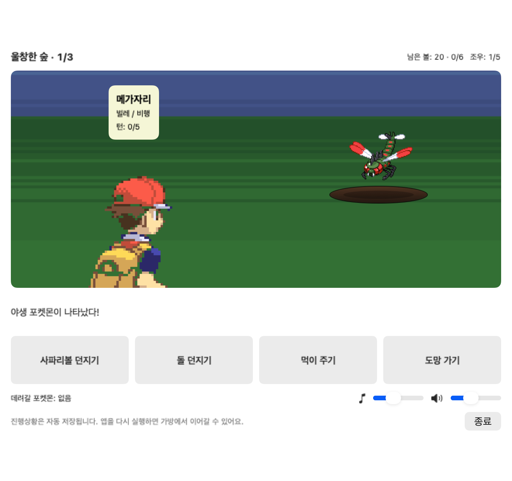

# Safari Zone

Buy a Safari Zone ticket for a fixed 300M in the Shop, then use it from the Bag.
The ticket is consumed when a starting area is chosen. An active trip can be resumed
from the Bag even when no tickets remain.

Choose a starting area from eleven text cards with a representative Pokémon. The
fixed roster contains 221 Gen I–V species, using final evolutions plus Pikachu.
Explore at most three distinct areas with 20 Safari Balls (6, 6, then 8). Each area
allows five encounters. The next area is selected once and saved; its modal must be
confirmed before the background changes or the next encounter begins. The same
species cannot appear in consecutive encounters, including after a restart.

Throw a Safari Ball, throw a rock, give bait or run. Ball/rock/bait throws follow a
parabola; ball art, particles, bounce and capture sounds use the bundled PokéRogue
assets. Existing Pokémon GIFs and static fallback bobbing remain active. Capture
and flee probabilities and numerical rock/bait effects are intentionally hidden.
Running pauses exploration until Continue is pressed.

Only one Pokémon is brought home. After another successful catch, choose whether
to replace the retained individual. Finish registers the retained Pokémon as a
level-100 graduate in the capture log and Collection, then closes the window. Its
nature and six individual stat grades (1–32) are rolled on encounter and preserved
through capture, save/reload and registration. Species base stats stay fixed.
Native window close asks for confirmation before finishing a running trip.

This is a new screen; no previous Safari screen existed in a released build.
See `Sources/PokeTokenBar/Resources/BattleText/safari-assets-notice.txt` and the
existing PokéRogue asset notices for capture rules, source revisions and artwork
attribution. Capture-result RNG and visual animation RNG remain separate.
