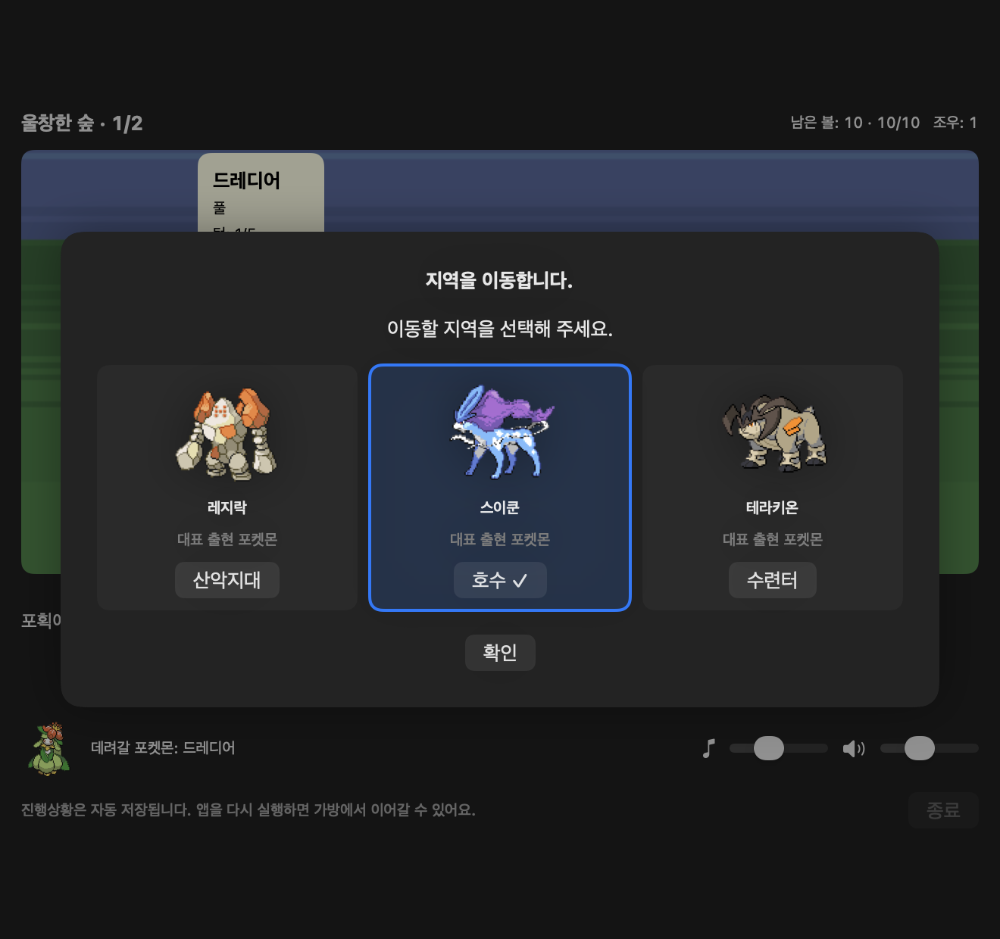

# Safari Zone

Buy a Safari Zone ticket for a fixed 200M in the Shop, then use it from the Bag.
The ticket is consumed when a starting area is chosen. An active trip can be resumed
from the Bag even when no tickets remain.

Choose a starting area from eleven text cards with a representative Pokémon. The
fixed roster contains 228 Gen I–V species, using final evolutions plus Pikachu.
Explore at most two distinct areas with 20 Safari Balls. Each area ends after ten
ball throws; encounter count and running away do not cause an area change. After
the first area's quota, three distinct unvisited destinations are drawn once and
saved. Select one and press Confirm before the background changes or the next
encounter begins. Reopening preserves the same three candidates. The second area's
quota or running out of balls finishes the trip. The same species cannot appear
in consecutive encounters, including after a restart.

Every area has a type-matched legendary or mythical encounter. Each eligible legendary/mythical
species has a 3% encounter chance. Volcano's Moltres and Ho-Oh each have 3%, for a
combined 6%; areas with one legend have a combined 3%. The immediately preceding
species is excluded first, so it contributes no probability on the next encounter;
remaining legends still receive 3% each. Legendary/mythical placements are fixed:

| Area | Legendary / mythical Pokémon |
|---|---|
| Plains | Regigigas |
| Dense forest | Celebi |
| Lake | Suicune |
| Mountains | Regirock |
| Desert | Groudon |
| Volcano | Moltres, Ho-Oh |
| City outskirts | Zapdos |
| Dojo | Terrakion |
| Dark cave | Darkrai |
| Mystic cave | Lugia |
| Ice cave | Articuno |

Throw a Safari Ball, throw a rock, give bait or run. Ball/rock/bait throws follow a
parabola; ball art, particles, bounce and capture sounds use the bundled PokéRogue
assets. Existing Pokémon GIFs and static fallback bobbing remain active. Current
capture and flee probabilities and the numerical rock/bait effects are
shown in the Pokémon panel and action buttons. Rock adds 5 percentage points to
capture and 10 to flee; bait subtracts 5 from capture and 10 from flee. Both effects
stack for the current encounter and reset when it ends; probabilities stay within
0–100%. The displayed ordinary flee chance
becomes 100% before the forced fifth-turn response; a successful catch takes priority.
Running pauses exploration until Continue is pressed.

Only one Pokémon is brought home. After another successful catch, choose whether
to replace the retained individual. Finish registers the retained Pokémon as a
level-100 graduate in the capture log and Collection, then closes the window. Its
nature and six individual stat grades (1–32) are rolled on encounter and preserved
through capture, save/reload and registration. Species base stats stay fixed.
Native window close asks for confirmation before finishing a running trip.

This is a new screen; no previous Safari screen existed in a released build.
See `Sources/PokeTokenBar/Resources/BattleText/safari-assets-notice.txt` and the
existing PokéRogue asset notices for capture rules, source revisions and artwork
attribution. Capture-result RNG and visual animation RNG remain separate.
